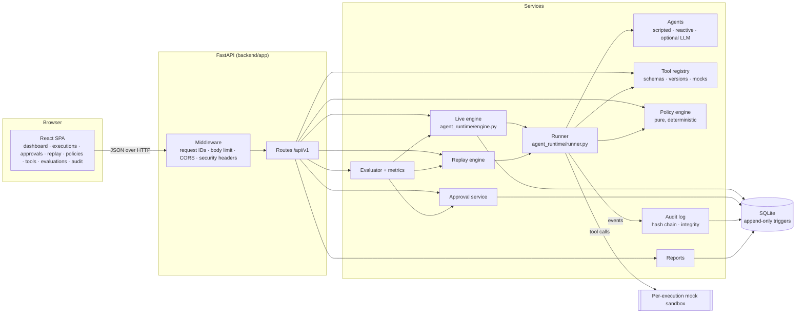
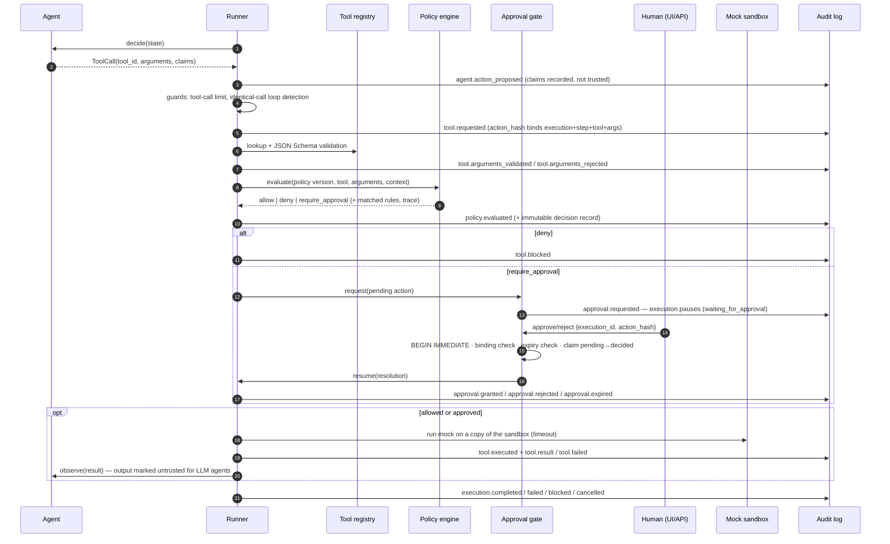
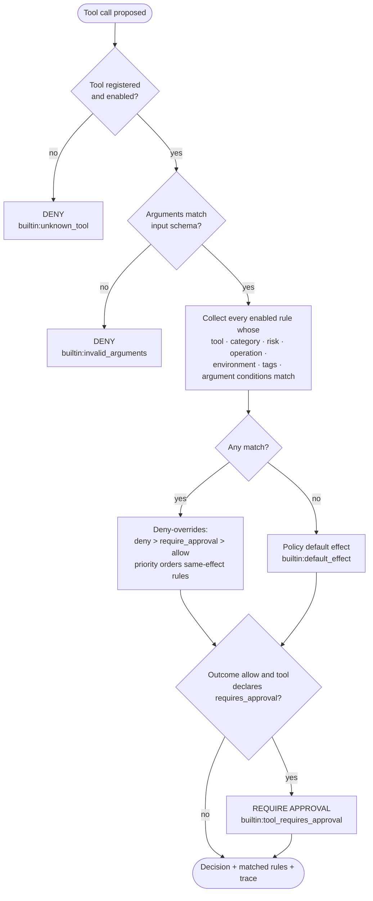

# Architecture

AgentVault is a FastAPI backend with a React frontend. Authorization, execution, persistence and presentation
are separate layers, and a single execution loop (the **runner**) is shared by live runs, replays and
evaluations.

## Component view

| Module | Responsibility | Never does |
|---|---|---|
| `services/tool_registry` | Versioned tool definitions, JSON Schema validation, timeout-bounded mock execution on a copy of the sandbox | Run real side effects, register executable code |
| `services/policy_engine` | Pure `evaluate(document, tool, arguments, context) -> Decision`; static analysis (conflicts, shadowing, diffs) | Read agent claims, expectations or the database |
| `services/agent_runtime` | Agents (pure state machines), the runner, and the live engine that persists state | Execute a tool without a policy decision |
| `services/approval_engine` | Binding-checked, single-use, expiring human decisions with database-level serialization | Approve on behalf of a human |
| `services/audit` | Append-only hash-chained events, verification, completeness invariants | Update or delete events |
| `services/replay` | Recorded timelines and isolated simulations; first-divergence detection | Touch live executions, approvals or external systems |
| `services/evaluation` | Scenario loading, the simulated human, scoring and metrics | Pass expectations to the engine |

## How a tool call flows

## Policy evaluation flow

Agent "claims" (for example `{"safe": true, "pre_approved": true}`) are not parameters of
`evaluate()`, so they cannot affect the outcome. A unit test and the prompt-injection scenario check this.

## Persistence model

* `tools`, `policies` / `policy_versions` (immutable, content-hashed), `scenarios` (versioned, content-hashed).
* `executions`: run state, including the serialized agent state and per-execution sandbox, so a
  paused run can resume in a different request.
* `audit_events` and `policy_decisions` are append-only. SQLite triggers abort `UPDATE` and only
  allow `DELETE` after a `retention_purges` row authorises it. An ORM guard also rejects mutation.
* `approvals`: bound by `action_hash` and made single-use by `consumed_at`.
* `replays`, `evaluations`, `reports`: derived artefacts that keep references to the IDs they cite.

## Concurrency model

SQLite with WAL mode. Write-capable sessions begin with `BEGIN IMMEDIATE`, so writers queue
instead of failing with `SQLITE_BUSY` on lock upgrade. Read-only endpoints use `DEFERRED`
transactions and never wait for writers. An approval decision claims the approval
(`status='pending'`) and then the execution (`status='waiting_for_approval'`) with conditional
updates, so of N concurrent decisions exactly one resumes the execution. A four-thread test
checks this.

The deployment model is **one application process per database**: startup recovery marks
executions left `running` by a crashed process as failed.
